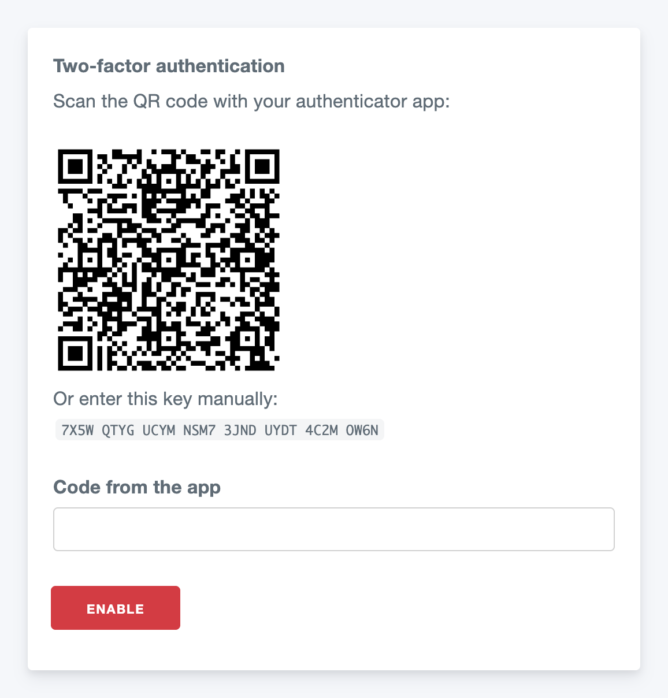

# CakePHP 2 Totp Plugin

[](LICENSE)
[](https://packagist.org/packages/pieceofcake2/totp)


[](https://github.com/pieceofcake2/totp/actions/workflows/CI.yml)
[](https://github.com/pieceofcake2/totp/actions/workflows/CI.yml)
[](https://codecov.io/gh/pieceofcake2/totp)

Two-factor authentication for the login of [pieceofcake2/cakephp](https://github.com/pieceofcake2/cakephp)
applications with time-based one-time passwords (TOTP, RFC 6238). The codes work with any
authenticator app: Google Authenticator, Microsoft Authenticator, 1Password, Bitwarden and others.

- `TotpComponent` provides a two-step login (password, then the code on a second page) and
  generates secrets and verifies codes when a user sets up two-factor authentication
- `TotpAuthenticate` checks the username, password and code from one form (one-step login)
- `TotpHelper` shows the secret as a QR code (generated on the server) and as text
- Optional replay protection: each code can be used only once



## Documentation

- Website: https://pieceofcake2.github.io/totp/ (日本語: https://pieceofcake2.github.io/totp/ja/)
- Markdown: [docs/README.md](docs/README.md) (日本語: [docs/ja/README.md](docs/ja/README.md)) (for AI tools and offline reading)

It covers the configuration, the database columns, the login and setup pages, replay protection,
security notes, the API reference and the migration from `ceeram/google-authenticate`.

The Markdown documentation is also included in the Composer package, in the plugin's directory: `plugins/Totp/docs/README.md` (the location depends on your `installer-paths`).

## Requirements

* PHP 8.0+
* pieceofcake2/cakephp 2.12+
* bacon/bacon-qr-code 2.0+ (optional, for the QR code)

## Installation

```bash
composer require pieceofcake2/totp
composer require bacon/bacon-qr-code
```

Load the plugin in `config/bootstrap.php` (legacy layout: `app/Config/bootstrap.php`):

```php
CakePlugin::load('Totp');
```

See [Installation](docs/README.md#installation) for the `installer-paths` setting.

## Usage

```php
public $components = [
    'Auth' => ['authenticate' => ['Form' => ['fields' => ['username' => 'email']]]],
    'Totp.Totp',
];

public function login()
{
    if ($this->request->is('post')) {
        $result = $this->Totp->login();
        if ($result === TotpComponent::LOGGED_IN) {
            return $this->redirect($this->Auth->redirectUrl());
        }
        if ($result === TotpComponent::CODE_REQUIRED) {
            return $this->redirect(['action' => 'verify']);
        }
        $this->Flash->error(__('Invalid email or password.'));
    }
}

public function verify()
{
    if (!$this->Totp->hasPendingLogin()) {
        return $this->redirect(['action' => 'login']);
    }
    if ($this->request->is('post') && $this->Totp->verifyLogin($this->request->data('User.code'))) {
        return $this->redirect($this->Auth->redirectUrl());
    }
}
```

Users with a secret in the `secret` column enter the current code of their authenticator app on the
second page. Users without a secret are logged in after the password. See
[Two-Step Login](docs/README.md#two-step-login) and
[Setting Up Two-Factor Authentication](docs/README.md#setting-up-two-factor-authentication).

## Contributing

See the [contribution guidelines](https://github.com/pieceofcake2/.github/blob/master/CONTRIBUTING.md).

## Origin

This package is a maintained fork of
[ceeram/GoogleAuthenticate](https://github.com/ceeram/GoogleAuthenticate)
(`ceeram/google-authenticate` on Packagist), originally by M. Ypes (Ceeram), renamed because the
codes are standard TOTP codes. It is maintained for CakePHP 2 on modern PHP by
[pieceofcake2](https://github.com/pieceofcake2). Changes from the original are listed in the
[commit history since the fork](https://github.com/pieceofcake2/totp/compare/df25ff4...1.x).

## License

Licensed under the MIT License. See [LICENSE](LICENSE).
